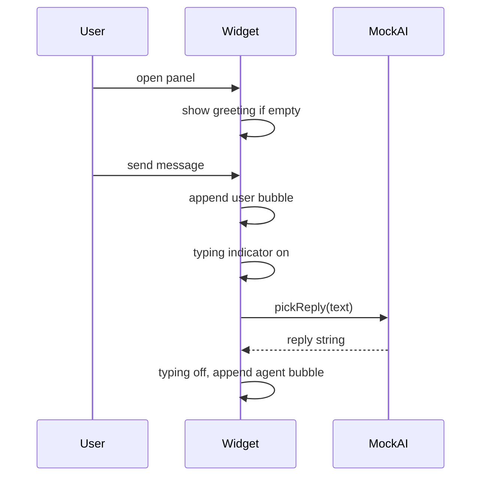

# Frontend чата ИИ-агента в стиле Jivo

## Контекст

Репозиторий сейчас пустой (кроме [`.cursor/rules/mock-data.mdc`](.cursor/rules/mock-data.mdc)). Реализация — **новый проект** на **Vite + React**, демо-страница с фоном «сайт клиента» и **встраиваемым виджетом** в правом нижнем углу.

## Референс UX (Jivo)

| Элемент | Поведение |
|---------|-----------|
| Launcher | Круглая кнопка с иконкой чата, badge при непрочитанном приветствии (опционально) |
| Панель | ~380×520px, скругления, тень, поверх контента (`position: fixed`) |
| Шапка | Аватар, имя агента, статус «В сети», кнопки свернуть/закрыть, **переключатель темы** |
| Лента | Приветствие при первом открытии; пузыри слева (агент) / справа (пользователь); время мелким текстом |
| Ввод | textarea + отправка по Enter (Shift+Enter — перенос), кнопка «Отправить» |
| ИИ | После сообщения пользователя — «Агент печатает…» 0.8–1.5 с, затем ответ из мока |



## Структура файлов

```
D:\Students\wed 1930\11\ai chat\
  package.json
  vite.config.js
  index.html
  src/
    main.jsx
    App.jsx                 # демо-лендинг + <ChatWidget />
    index.css               # CSS-переменные тем, reset
    components/
      ChatWidget.jsx        # состояние open/minimized, композиция
      LauncherButton.jsx
      ChatPanel.jsx
      ChatHeader.jsx
      MessageList.jsx
      MessageBubble.jsx
      ChatInput.jsx
      TypingIndicator.jsx
    hooks/
      useChat.js            # messages, send, typing, scroll ref
    context/
      ThemeContext.jsx      # light/dark + localStorage
    mock/
      agent.js              # имя, роль, avatar (инициалы/цвет)
      initialMessages.js    # стартовое приветствие
      replies.js            # шаблоны ответов по ключевым словам + fallback
    utils/
      delay.js
```

## Мок-данные (по правилу workspace)

- [`src/mock/agent.js`](src/mock/agent.js): агент «Алексей», «Консультант», статус online.
- [`src/mock/initialMessages.js`](src/mock/initialMessages.js): 1–2 сообщения от агента (приветствие, «чем помочь?»).
- [`src/mock/replies.js`](src/mock/replies.js): 5–8 сценариев (цена, доставка, «привет», неизвестный запрос) + общий fallback; структура как будущий API: `{ id, role, text, createdAt }`.
- В [`src/hooks/useChat.js`](src/hooks/useChat.js): `const USE_MOCK = true` и функция `getAgentReply(userText)` — единственная точка, позже заменить на `fetch`.

## Темы

- [`src/context/ThemeContext.jsx`](src/context/ThemeContext.jsx): `theme` = `light` | `dark`, сохранение в `localStorage` (`chat-widget-theme`).
- [`src/index.css`](src/index.css): переменные `--bg-panel`, `--bg-user`, `--bg-agent`, `--accent` (зелёный в духе Jivo в light; приглушённый в dark).
- Кнопка-иконка (солнце/луна) в [`ChatHeader.jsx`](src/components/ChatHeader.jsx); тема применяется к корню виджета (`data-theme`), не ко всей демо-странице — чтобы виджет можно было вынести отдельно.

## UI и доступность

- Фокус в поле ввода при открытии панели; `aria-label` на launcher и кнопках шапки.
- Автоскролл к последнему сообщению (`scrollIntoView` на ref в `MessageList`).
- Состояния: закрыто → открыто → свёрнуто (только launcher, без уничтожения истории в сессии).
- Демо-фон в `App.jsx`: короткий текст «Пример сайта», чтобы виджет выглядел как на реальном лендинге.

## Зависимости

- `react`, `react-dom`
- dev: `vite`, `@vitejs/plugin-react`
- Без UI-библиотек на первом этапе — чистый CSS modules или один глобальный BEM-префикс `.chat-widget__*` для простоты и контроля «как Jivo».

## Проверка после реализации

1. `npm install` → `npm run dev`
2. Открыть localhost: кнопка в углу, открытие панели, приветствие.
3. Отправить сообщение — индикатор печати, ответ по моку.
4. Переключить тему — контраст пузырей и шапки, перезагрузка страницы сохраняет выбор.
5. Свернуть/закрыть — история сохраняется до перезагрузки (state в React; при желании позже — `sessionStorage`).

## Что сознательно не входит в v1

- Реальный API / стриминг токенов
- Вложения файлов, emoji-picker, оценка диалога
- Отдельный npm-пакет «вставь скрипт на любой сайт» (можно добавить вторым этапом: build IIFE + `data-widget`).
